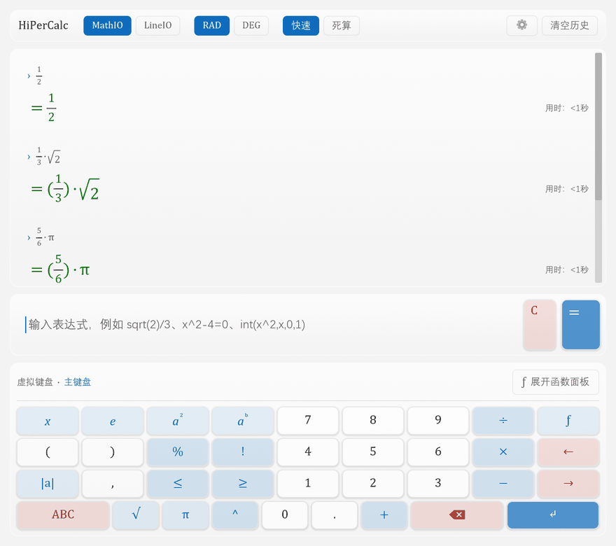
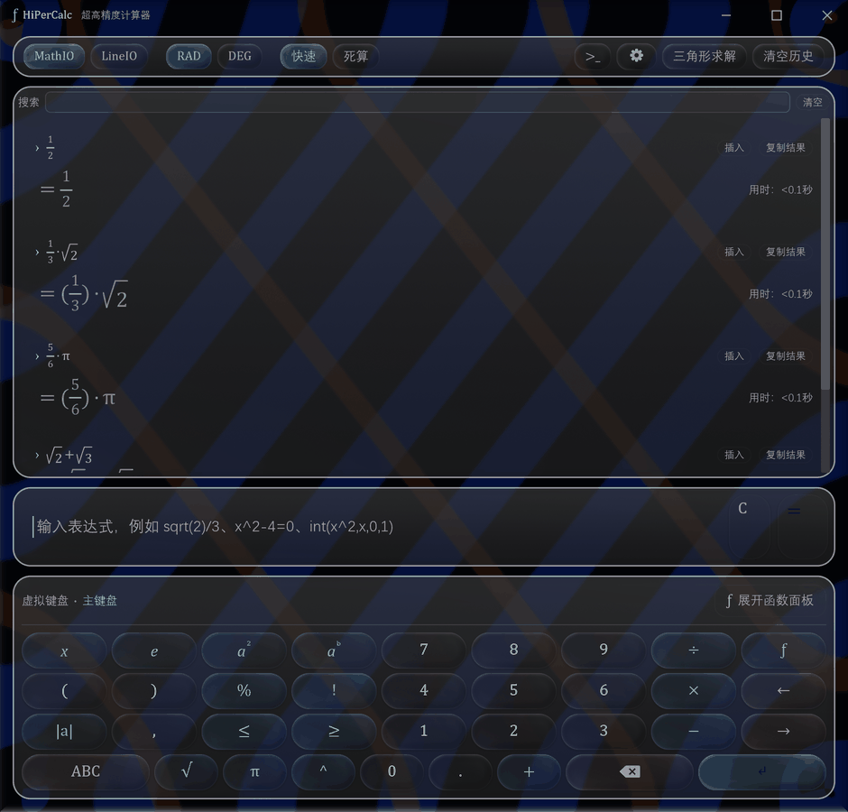

# HiPerCalc

[](https://github.com/EasonZYQ/high_precision_calc/actions/workflows/ci.yml)
[](https://github.com/EasonZYQ/high_precision_calc/releases/latest)
[](LICENSE)
[](#安装)
[](https://www.rust-lang.org/)
[](docs/DOC.zh-CN.md)
[](.github/workflows/ci.yml)
[](crates/hipercalc-gui)
[](docs/DOC.zh-CN.md)
[](https://github.com/EasonZYQ/high_precision_calc/stargazers)
[](https://github.com/EasonZYQ/high_precision_calc/releases)
[](https://github.com/EasonZYQ/high_precision_calc/commits/main)

[English](README.en.md) · **简体中文**

**超高精度计算器**：命令行 + 图形界面两个前端，**80 位精度**，能精确就绝不给近似值。
Rust 写成，单个可执行文件，Windows / Linux / macOS 通用，界面支持简体中文 / 繁體中文 / English。

<p align="center">
  
  
</p>

## 特色

- **算得准** —— 80 位精度；`1/3+1/6` 直接给 `1/2`，切 MathIO 显示分数与根式
- **会高等数学** —— `diff` / `lim` / `int` / `taylor` / `sum` / `prod`，结果可继续参与运算
- **能解方程** —— 方程 / 方程组 / 不等式；给出**全部**根（含复数），三角方程给周期通式
- **不止四则** —— 三角形求解、因式分解、矩阵与线性代数、统计、数制与位运算、带量纲单位、特殊函数、物理常量
- **两个前端** —— 带语法高亮的 REPL（Tab 补全 / 括号配对 / 参数提示）与 Iced 图形界面（Desmos 式虚拟键盘、数学排版、液态玻璃、深浅双主题）
- **三语界面** —— 简体中文 / 繁體中文 / English，随时 `/lang` 切换

```
> 1/3+1/6
= 0.5
> (x-2)(x+3)+2x=12
x = 3, x = -6
> x^4-5x^2+4>0
x ∈ (-∞, -2) ∪ (-1, 1) ∪ (2, ∞)
> 3 km / 2 second
= 1500 m/s
> sum(k,k,1,1000000)
= 500000500000
```


## 安装

从 [Releases](https://github.com/EasonZYQ/high_precision_calc/releases) 下载对应平台的可执行文件
（Linux / macOS 需先 `chmod +x`；GitHub 不保留可执行位）。或自行构建（需要 Rust 1.85+）：

```bash
cargo build --release                     # 命令行 → target/release/hipercalc
cargo build -p hipercalc-gui --release    # 图形界面 → target/release/hipercalc-gui
```

图形界面三平台都有（Windows / macOS / Linux）；**同一个 exe 带参数时就是命令行版**（`hipercalc-gui -e "1+1"`），工具栏的 `>_` 也能直接开一个独立命令行窗口。Linux 需要 `libxkbcommon-x11-0` 与 `libwayland-client0`；
「玻璃质感」用的是 Windows 的桌面复制，其它平台自动退回「关闭」。

## 文档

- 📘 [完整文档（中文）](docs/DOC.zh-CN.md) · [Full manual (English)](docs/DOC.en.md) —— 每个函数、每条指令、所有开关
- 🧭 [代码结构说明 CODEDOC](docs/CODEDOC.zh-CN.md) · [English](docs/CODEDOC.en.md) —— 想改代码看这份（关键类型 / 数据流 / 扩展指南）
- 🎨 [液态玻璃实现笔记](docs/liquid-glass-report.md) —— 玻璃算法、帧预算与实测
- 🧩 [Windows 7 兼容性调研](docs/windows7.md)
- 🤝 [贡献指南](CONTRIBUTING.md) · [Contributing](CONTRIBUTING.en.md)

## 许可

[MIT](LICENSE) © 2026 EasonZYQ
