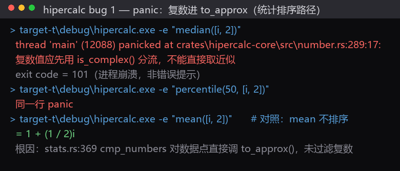
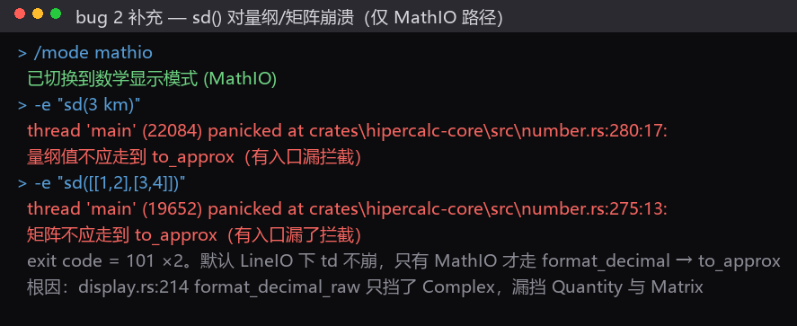
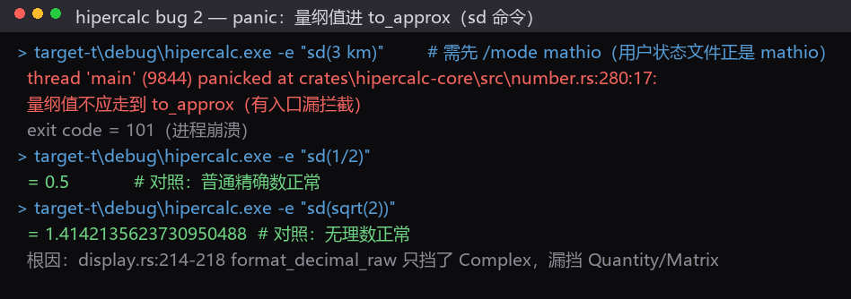
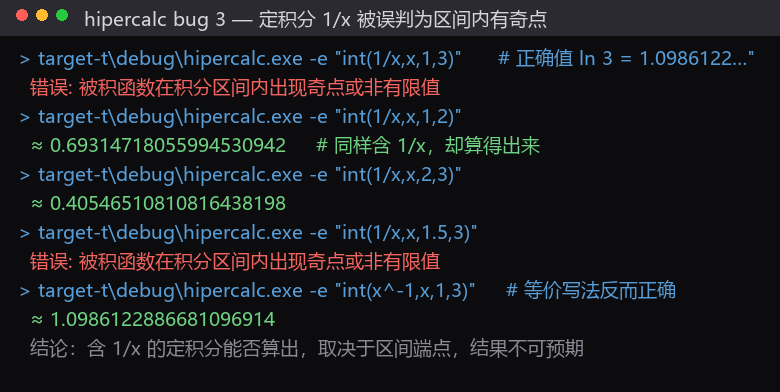
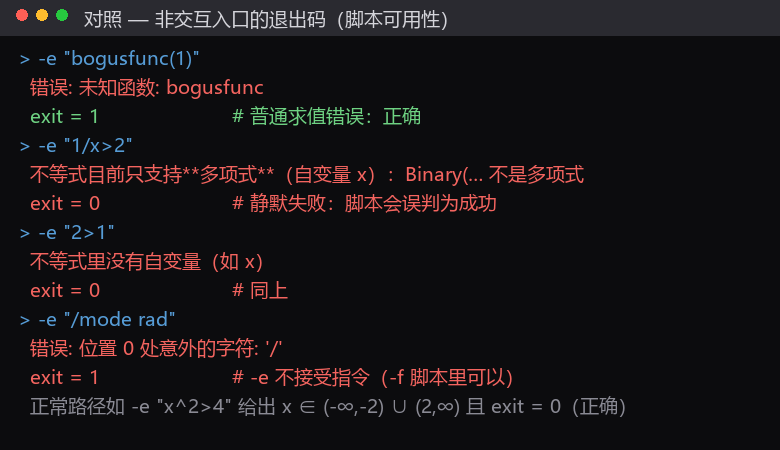
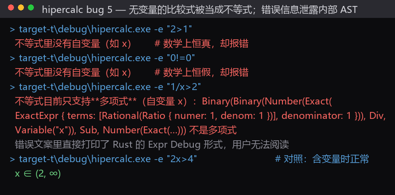
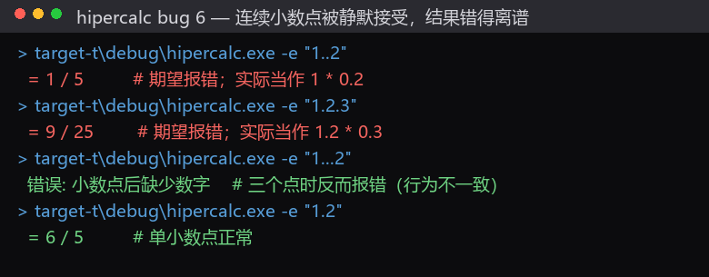
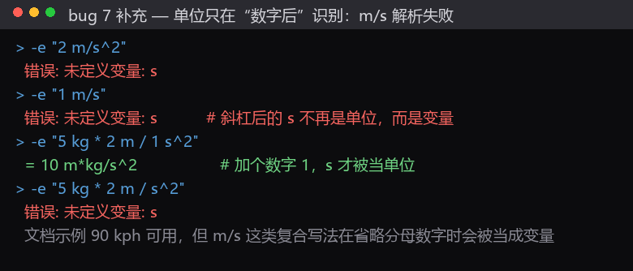
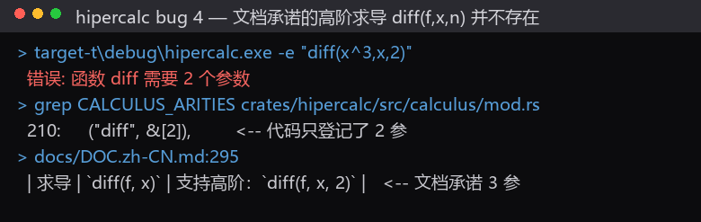

# hipercalc 测试报告：缺陷与改进建议

- **被测对象**：`E:\setup\Java\Rust\high_precision_calc`（Rust 双 crate workspace，edition 2024）
- **被测版本**：工作区当前源码，构建产物 `target-t\debug\hipercalc.exe`
- **测试方式**：黑盒实测（321 条独立用例）+ 全量单元测试 + 静态代码审查 + 文档逐条核对
- **截图目录**：[audit/shots/](shots/)（10 张，均为实测输出的终端风格还原）

> 本报告与仓库中已有的 [TEST_REPORT.md](../TEST_REPORT.md)（2026-09，提到 62 项测试）不是同一份，未覆盖它。

---

## 一、执行摘要

| 维度 | 结果 |
|---|---|
| 构建 | `cargo build --workspace --all-targets` 成功，**49.0 s**（全新 target 目录） |
| 单元测试 | **197 项全绿**（hipercalc 180 / core 17 / doctest 1，其中 1 项 `perf_scan` 默认 ignore）；编译+测试 **20.1 s**，纯测试 **7.93 s + 0.32 s + 0.05 s** |
| 黑盒自测 | 221 条（默认设置）+ 100 条（干净会话 rad/fast），每例独立进程；另有针对可疑点的定向复现 |
| **崩溃级缺陷** | **3 个**（一行输入即 panic 退出，exit code 101） |
| **算错级缺陷** | **2 个**（`gamma` 半整数数值错误；含 `1/x` 的定积分被误拒） |
| **退出码/静默失败** | **1 类**（部分错误只写 stderr，退出码仍为 0） |
| **文档与实现不符** | **22 条**（含 4 条"文档承诺的功能根本不存在"） |
| **代码可维护性问题** | **10 项**（含一个 829 行的单函数） |

**最该先修的五件事（按性价比排序）**：

1. `gamma(1/2)` 在**默认设置**下返回 `≈ 1`（正确值 `1.7724538509055160273`）—— 用户默认看到的就是错值。
2. `median([i, 2])` 让进程 **panic 崩溃**（不是友好报错）。
3. `sd(3 km)` / `sd([[1,2],[3,4]])` 在 **MathIO 模式**下 panic（两个不同断点）。
4. `int(1/x,x,1,3)` 被误判为"区间内有奇点"而拒绝（正确值 `ln 3 ≈ 1.0986122886681`）。
5. `int(1/x,x,1,3)` 这类失败退出码为 0 —— 脚本/CI 会误判成功。

---

## 二、测试环境与方法

### 2.1 环境

- 工具链 stable-x86_64-pc-windows-msvc；`Cargo.toml` 的 `[profile.dev.package."*"] opt-level = 3` 生效（依赖优化、本项目源码 `opt-level = 0`）。
- 工作区 `target\` 被 Windows 权限挡住（`cargo` 报 `failed to open target\debug\.cargo-build-lock ... 拒绝访问 (os error 5)`），已用 ACL 诊断脚本修复 `target`、`target\debug`、`change_logs` 三处目录权限；为避免旧锁文件残留影响，构建改用独立目标目录 `target-t\`。
- 非交互入口：`-e "表达式"`（单条）、`-f 脚本`（逐行）、`--stdin`。

### 2.2 一个必须先讲清的前提：状态文件会改变"默认值"

用户主目录的 `~/.hipercalc_state` 当前内容是：

```text
display=mathio        ← 数学符号显示
angle=deg             ← 角度制
calc=deep             ← 死算模式
lang=zh-CN / prec=80 / digits=20 / sci=on / group=off
```

因此同一表达式在两种环境下结果完全不同：

| 输入 | 直接 `-e`（读状态：deg + deep） | 干净会话（`/mode rad` + `/mode fast` + `/mode lineio`） |
|---|---|---|
| `sin(1)` | `≈ 0.017452406437283512819`（= sin 1°） | `≈ 0.84147098480789650665` ✅ |
| `cos(1)` | `≈ 0.99984769515639123916` | `≈ 0.5403023058681397174` ✅ |
| `tan(1)` | `≈ 0.017455064928217585765` | `≈ 1.5574077246549022305` ✅ |
| `arctan(1)` | `= 45` | `≈ 0.78539816339744830962` ✅ |
| `1e1000*1e1000` | 输出 2001 位整数 | `≈ 1×10^2000`（科学计数法） |

**这不是缺陷**（状态持久化是设计功能），但它引出文档问题 D6/D7，且是复现其他问题前必须先确认的前提。本报告默认区分两种环境。

### 2.3 一个重要提醒：`-f` 脚本的参数文件**不能带 BOM**

`Set-Content -Encoding utf8`（Windows PowerShell 5.1）会写入 UTF-8 BOM，而程序会把首行读成 `/mode rad`（前面多了 `\ufeff`），于是**所有 `/mode` 前置命令静默失效**：

```text
错误: 位置 0 处意外的字符: ''
已切换到数学显示模式 (MathIO)      ← 后续 /mode 生效，但第一条被吞
```

结果是"看起来设置了弧度制，其实还在角度制"。这不是程序 bug（BOM 是非法的表达式字符），但建议程序**在读取脚本首行时忽略 BOM**，否则脚本化验证极易踩坑。

---

## 三、缺陷清单

### 【P0】崩溃（panic，exit code 101）

#### B1. `median` / `percentile` 遇到复数数据点直接 panic



```text
$ hipercalc -e "median([i, 2])"
thread 'main' (12088) panicked at crates\hipercalc-core\src\number.rs:289:17:
复数值应先用 is_complex() 分流，不能直接取近似
exit code = 101
```

- **同样触发**：`percentile(50, [i, 2])`。
- **不触发的对照**：`mean([i, 2])` → `= 1 + (1 / 2)i`（`mean` 不做排序）。
- **根因**：`crates/hipercalc/src/stats.rs:369` 的 `cmp_numbers` 对数据点直接求近似值：

  ```rust
  fn cmp_numbers(a: &Number, b: &Number) -> std::cmp::Ordering {
      let d = BigFloat::sub(&a.to_approx(), &b.to_approx(), 40);   // ← 命中 debug_assert
  ```

  而 `Number::to_approx()` 对复数带 `debug_assert!(false)`（`crates/hipercalc-core/src/number.rs:289`）。debug 构建直接崩溃；**release 构建会静默丢掉虚部**（见 B6）。
- **建议**：比照 `solver_poly.rs` 的写法，在 `concrete_values` / `cmp_numbers` 入口先 `is_complex()` 过滤并返回可翻译的错误（"中位数/百分位不支持复数数据点"）。

#### B2. `sd()` 对量纲值与矩阵在 MathIO 下 panic（两个断点）



```text
$ hipercalc -f probe.txt          # 文件内容：/mode mathio ; sd(3 km)
已切换到数学显示模式 (MathIO)
thread 'main' (22084) panicked at crates\hipercalc-core\src\number.rs:280:17:
量纲值不应走到 to_approx（有入口漏拦截）
exit code = 101

$ hipercalc -f probe2.txt         # /mode mathio ; sd([[1,2],[3,4]])
thread 'main' (19652) panicked at crates\hipercalc-core\src\number.rs:275:13:
矩阵不应走到 to_approx（有入口漏了拦截）
exit code = 101
```

- **触发条件**：**仅 MathIO 模式**。默认 LineIO 下 `sd(3 km)` 给 `= 3000 m`（正常），因为只有 MathIO 才走 `format_decimal`。
- **为什么仍然重要**：① 用户当前的状态文件就是 `display=mathio`；② `docs/DOC.zh-CN.md:341` 声称 MathIO 是默认（见 D6）。
- **根因**：`crates/hipercalc-core/src/display.rs:214` 的 `format_decimal_raw` 只挡了 `Complex`：

  ```rust
  fn format_decimal_raw(num: &Number) -> String {
      if let Number::Complex(z) = num { return format_complex(z, &format_decimal); }
      let bf = num.to_approx();     // ← Quantity / Matrix 在这里命中 debug_assert
  ```

  同文件的 `format_mathio_raw` 是挡了的（`display.rs:37-38`），属"两条格式化路径不一致"。
- **建议**：`format_decimal_raw` 补 `Quantity` → `format_quantity`、`Matrix` → `matrix::render` 分支。

#### B3. `sd()` 对量纲值 panic（同一根因的另一份证据）



与 B2 完全同源（`display.rs:214`）。保留两张图是因为它同时说明了**对照用例正常**：`sd(1/2)`、`sd(sqrt(2))` 都没问题。

### 【P1】算错 / 拒绝正确计算

#### B4. `gamma` 的正半整数在**默认设置**下给出错误数值

```text
# 真默认设置（USERPROFILE 指向空目录）
$ hipercalc -e "gamma(1/2)"      # 数学值 1.7724538509055160273
≈ 1
$ hipercalc -e "gamma(3/2)"      # 数学值 0.88622692545275801365
≈ 0.5
$ hipercalc -e "gamma(5/2)"      # 数学值 1.3293403881791370205
≈ 0.75
$ hipercalc -e "gamma(7/2)"      # 数学值 3.3233509704478425512
≈ 1.875
$ hipercalc -e "gamma(1/2)*2"    # 数学值 3.5449077018110320546
≈ 2
```

切到 MathIO 就正确（说明**精确形式算对了，是数值化那一步错**）：

```text
> /mode mathio
> gamma(1/2)
= sqrt(pi)
> gamma(3/2)
= 1 / 2*sqrt(pi)
> gamma(5/2)
= 3 / 4*sqrt(pi)
```

- **根因**：`crates/hipercalc-core/src/number.rs:983-998` 的 `ExactTerm::PiPow(coeff, k)` 数值化分支：

  ```rust
  let int_part = k.numer() / k.denom();   // k = 1/2 ⇒ int_part = 0
  // …整数部分连乘（此处什么都没乘）
  pw = pw.sqrt(pr);                       // 对 1 开方 ⇒ 仍是 1
  ```

  即"整数部分为 0 且指数含 1/2"时**少乘一次 π**（应为 `sqrt(π^1)`）。代码注释自称"把 k 拆成整数部分 + 0/半"，但漏了整数部分为 0 的情形。
- **为什么严重**：默认显示模式是 LineIO，所以**用户默认看到的就是错值**；而 `docs/DOC.zh-CN.md:118` 恰好用 `gamma(1/2)` = `sqrt(pi)` 作为卖点。
- **建议**：`int_part == 0` 时先 `pw = pi` 再按半次开方；补一条"LineIO 下断言 `gamma(1/2)` 数值"的单元测试。

#### B5. 含 `1/x` 的定积分被误判为"区间内有奇点"



```text
$ hipercalc -e "int(1/x,x,1,3)"      # 数学值 ln 3 = 1.0986122886681096914
错误: 被积函数在积分区间内出现奇点或非有限值
$ hipercalc -e "int(1/x,x,1,2)"
≈ 0.69314718055994530942            # 同样含 1/x，却算得出来
$ hipercalc -e "int(1/x,x,2,3)"
≈ 0.40546510810816438198
$ hipercalc -e "int(1/x,x,1.5,3)"
错误: 被积函数在积分区间内出现奇点或非有限值
$ hipercalc -e "int(x^-1,x,1,3)"     # 等价写法反而正确
≈ 1.0986122886681096914
```

- **影响面**：含显式分式 `1/x` 的定积分能否算出**取决于区间端点**——实测 `[1,2]`、`[2,3]`、`[3,4]`、`[4,5]` 可以，`[1,3]`、`[1.5,3]`、`[0.5,3]`、`[1,10]` 不行。用户可以绕开（写 `x^-1`），但完全无法预期。
- **根因（已定位）**：`crates/hipercalc/src/calculus/integrate.rs:500` 的 `singular_inside` 用 `solve_aux::collect_all_roots` 收集分母的根。该函数返回的是**含伪根**的集合——实测对分母 `x` 会额外返回 `1/2/3/5/6` 一类牛顿迭代残渣。随后第 545 行"排除落在端点附近的伪根"的判据是

  ```rust
  let tol = -(hipercalc_core::bigfloat::display_digits() as f64) * 10.0;   // = -200
  if fa.magnitude_log10() > tol && fb.magnitude_log10() > tol { return Ok(true); }
  ```

  对于落在区间**内部**的伪根（如伪根 2、3 落在 `[1,3]` 内），这个判据无法识别，于是误报奇点。
- **建议**：① 把候选根**代回验算**（`|d(root)|` 与系数尺度比较）再判奇点；② 顺带评估 `collect_all_roots` 的伪根问题（它会污染其他调用方）。

### 【P2】行为与退出码问题

#### B6. release 构建下复数与量纲值会被静默"丢掉虚部/量纲"

`Number::to_approx()` 对复数只取实部、对量纲只取数值，保护手段全是 `debug_assert!`（release 失效）。除 B1/B2 两处已确认崩溃的入口外，还有至少两处缺少 `is_complex()` 过滤：

| 位置 | release 下的症状 |
|---|---|
| `crates/hipercalc/src/stats.rs:369` | 排序/比较时复数静默取实部 |
| `crates/hipercalc/src/parser.rs:1131`（`zeta_numeric` 开头 `let sv = s.to_approx();`） | 复数参数按实部计算 |
| `crates/hipercalc-core/src/display.rs:218` | 量纲/矩阵显示成纯数字 |

**建议**：这三处补显式过滤；更彻底的做法是让 `to_approx()` 返回 `Result`（改动较大，可列为长期项）。

#### B7. 部分错误只写 stderr 而退出码为 0（脚本无法感知失败）



```text
$ hipercalc -e "bogusfunc(1)"   ; exit = 1    ← 普通求值错误：正确
$ hipercalc -e "1/x>2"          ; exit = 0    ← 输出"不等式目前只支持**多项式**…"到 stderr，却返回成功
$ hipercalc -e "2>1"            ; exit = 0    ← 同理
$ hipercalc -e "sqrt(x)>2"      ; exit = 0    ← 同理
$ hipercalc -e "x^2>4"          ; exit = 0    ← 正常路径 + 正确结果，exit 0 正确
```

- 文档承诺退出码"正常 0、计算错误 1、启动参数错误 2"（`docs/DOC.zh-CN.md:67`）。
- **影响**：CI 或批处理用 `-e` 判成败会**误判为成功**。
- **建议**：让不等式路径把错误作为返回值而非直接打印；或让 `run_line` 在"结果串为空且已向 stderr 报错"时返回 `is_err = true`。

#### B8. 无变量的比较式被当成不等式，且错误信息泄露内部 AST



```text
$ hipercalc -e "2>1"
不等式里没有自变量（如 x）        ← 数学上恒真，却报错
$ hipercalc -e "0!=0"
不等式里没有自变量（如 x）        ← 数学上恒假，却报错（3<5、1!=2、5>=5 同样）
$ hipercalc -e "1/x>2"
不等式目前只支持**多项式**（自变量 x）：Binary(Binary(Number(Exact(ExactExpr { terms:
[Rational(Ratio { numer: 1, denom: 1 })], denominator: 1 })), Div, Variable("x")),
Sub, Number(Exact(…))) 不是多项式
```

- 三点问题：
  1. 无自变量的比较式被"不等式识别"抢先认领，然后报"没有自变量"；用户期待的是真/假或更明确的提示。
  2. 错误文案里打印了 Rust 的 **`Expr` Debug 形式** —— 既不可读，也把内部实现暴露给用户。位置：`crates/hipercalc/src/solver_ineq.rs:108` 的 `format!("… {f:?} 不是多项式")`。
  3. 这些错误退出码为 0（见 B7）。
- **建议**：① 无变量时给出明确结论（`恒成立` / `不成立`）或提示"请输入含自变量的不等式"；② 用 `calculus::render` 一类渲染器替换 `{f:?}`。

#### B9. 连续小数点被静默接受



```text
$ hipercalc -e "1..2"
= 0.2            ← 期望报错；实际当作 1 * 0.2（MathIO 下显示 = 1 / 5）
$ hipercalc -e "1.2.3"
= 0.36           ← 期望报错；实际当作 1.2 * 0.3（MathIO 下 = 9 / 25）
$ hipercalc -e "1...2"
错误: 小数点后缺少数字      ← 三个点时反而报错（行为不一致）
$ hipercalc -e "1.2"
= 1.2            ← 单小数点正常
```

- **建议**：`parse_number` 消费完小数部分后，若下一字符又是 `.` 且后跟数字，直接报"位置 N 处多余的小数点"，不要回退成隐式乘法。

#### B10. 单位只在"数字之后"识别，导致 `m/s` 这类写法失败



```text
$ hipercalc -e "2 m/s^2"
错误: 未定义变量: s
$ hipercalc -e "1 m/s"
错误: 未定义变量: s          ← 斜杠后的 s 不再是单位，而是变量
$ hipercalc -e "5 kg * 2 m / 1 s^2"
= 10 m*kg/s^2                 ← 加个数字 1，s 才被当单位
```

- 这是 `docs/DOC.zh-CN.md:191` 明确写的规则（"单位只在数字后面才算单位"），但用户按物理惯例写 `m/s` 会失败，而文档的示例都是 `90 kph` 这类不含斜杠的形式。
- **建议**：至少在错误信息里给出提示（"`s` 被当作变量；单位需紧跟在数字后，如 `2 m / 1 s`"），或对已知单位名在除号后做特例识别。

#### B11. `diff` 的高阶求导（3 参数）不存在，文档却承诺支持



```text
$ hipercalc -e "diff(x^3,x,2)"
错误: 函数 diff 需要 2 个参数
```

- **代码事实**：`crates/hipercalc/src/calculus/mod.rs:210` 为 `("diff", &[2])` —— 只登记 2 参；`mod.rs:377-382` 的实现也只取 `args[0]` 与变量。
- **文档事实**：`docs/DOC.zh-CN.md:295` 写"求导 `diff(f, x)` … **支持高阶：`diff(f, x, 2)`**"；`docs/DOC.en.md:254` 同样。
- **建议**：实现 3 参形式（对 `diff::diff` 循环调用即可），或删除文档中"支持高阶"的表述。

### 【P3】界面一致性

#### B12. 新模块（矩阵、量纲、统计、不等式）的用户可见文案**未进入 i18n 词条表**

`docs/DOC.zh-CN.md:351` 承诺三语界面，`CONTRIBUTING.md` 要求各语言键集一致，但实测：

```text
$ hipercalc --lang en -e "1 km + 2 second"
Error: 量纲不同，不能相加减：m 与 s        ← "Error:" 已翻译，正文没翻译
```

`crates/hipercalc/src/language/en.json` 中 `矩阵`、`量纲`、`统计`、`方阵`、`不可逆`、`特征值`、`数据点`、`百分位`、`中位数` 命中数**全为 0**。涉及位置（举例）：

- `crates/hipercalc-core/src/matrix.rs:106` `"只有方阵才能做幂运算"`、`:198` `"矩阵不可逆（存在全零列）"`、`:229` `"右端向量长度应为 {n}"`
- `crates/hipercalc/src/stats.rs:119` `"{name} 至少需要两个数据点：…"`、`:189` `"百分位必须在 0 到 100 之间"`、`:247` `"corr 用法：…"`
- `crates/hipercalc/src/solver_ineq.rs:108` `"不等式目前只支持**多项式**…"`
- `crates/hipercalc/src/parser.rs:2911` `"量纲不同，不能相加减：{} 与 {}"`、`:2921` `"带量纲的值不能与无量纲的数相加减（乘除则可以）"`

**建议**：逐字补进 `en.json` + `zh-TW.json`（`language::tests` 会自动校验键集与占位符对齐）。

#### B13. `/help` 正文重复且互相矛盾，简体正文混入繁体

`crates/hipercalc/src/lib.rs`：

- `:4225` 与 `:4226` 是**两条 zeta 说明且互相矛盾**：
  - `zeta(s)  黎曼 ζ：偶数点给精确闭式（zeta(2) = pi^2/6）；奇数点与非整数走 Euler-Maclaurin 数值（zeta(3) ≈ 1.2020569032）`
  - `zeta(s)  黎曼 ζ：偶数点给精确闭式（zeta(2) = pi^2/6）；奇数点暂无闭式，报错提示` ← 与实测矛盾（`zeta(3)` 给 `≈ 1.2020569031595942854`，不报错）
  - 繁体 `:4061-4062`、英文 `:4139-4140` 有同样的重复矛盾对。
- `:4233` 位于**简体** `HELP_TEXT` 区间内却整行是繁体：`矩陣     [[1,2],[3,4]]（也是變數/ans 可存的值）；det/inv/trace/transpose/rank、*（矩陣乘）、^（整數次幂）`

#### B14. `FUNCTIONS_META` 的 `corr` 元数与实现不符（框内提示会误报"参数过多"）

- `crates/hipercalc/src/lib.rs:162-167`：`FnMeta { name: "corr", min: 5, max: 5, sig: "(x, y, k, a, b)" }`
- 实现同时接受 `corr([xs], [ys])`（`crates/hipercalc/src/stats.rs:259-270` 的文档注释与 `:247` 的报错文案都写了两种形式），而手册给的例子正是两参形式（`docs/DOC.zh-CN.md:141`，实测 `= 1` ✅）。
- **结果**：用户在 `corr([1,2,3],[2,4,6])` 的括号内会看到红色"参数过多"提示，而输入本身是对的。
- **建议**：`min: 2, max: 5`，`sig` 改成 `"(x, y, k, a, b) 或 ([xs], [ys])"`。

#### B15. 状态文件恢复时不做范围校验

`crates/hipercalc/src/state.rs:183-190` 对 `prec=` / `digits=` 只做 `parse::<usize>()`，随后 `crates/hipercalc/src/lib.rs:1904-1905` 直接 `set_precision` / `set_display_digits`，**绕过了 `/mode prec <20..2000>`、`/mode digits <1..prec>` 的校验**。手写 `prec=0` / `digits=0` / `prec=999999999` 会得到怪异输出（不崩溃）。

#### B16. `sum` / `prod` 上下限的中间量有 `i64` 溢出风险

`crates/hipercalc/src/calculus/sumprod.rs:44`（以及 `:122` 的 `prod`）：

```rust
let count = (b - a + 1) as u128;
```

`a`、`b` 是用户可控的 `i64`（`bounds()` 只用 `try_into::<i64>()` 卡范围）。跨度接近 `i64` 极限时，`b - a + 1` 会先按 `i64` 溢出：debug 构建 panic，release 回绕成负数再 `as u128` 变得极大，**穿过后续所有预算检查**。

> **实测说明**：`sum(k,k,-1e18,1e18)`、`sum(k,k,1,1e18)` 在本机走闭式公式路径（分别得 `= 0`、`= 500000000000000000500000000000000000`），未命中有问题的逐项分支，因此该缺陷**本轮未复现**，属代码层面的风险。
> **建议**：改为 `(b as i128 - a as i128 + 1) as u128`。

---

## 四、文档与实现不一致（D 项）

### 4.1 文档承诺、代码没有（4 条）

| 编号 | 文档位置 | 文档说法 | 实测 |
|---|---|---|---|
| **D1** | `docs/DOC.zh-CN.md:92`、`docs/DOC.en.md:86` | 内置数论函数含 **`prevprime(100)`** | `错误: 未知函数: prevprime`；`prevprime` 在全仓库 `*.rs` 中 **0 命中**（只有 `nextprime`） |
| **D2** | `docs/DOC.zh-CN.md:128`、`docs/DOC.en.md:123` | "进制转换：**`bin(10)`**、**`hex(255)`** 等" | `bin(10)`、`hex(255)`、`oct(8)`、`dec(10)` 全部 `错误: 未知函数`；它们只作为 `/base` 的参数取值存在（`crates/hipercalc/src/lib.rs:2129-2131`）。`/base hex` 后算 `255` → `= 0xff` ✅ |
| **D3** | `docs/DOC.zh-CN.md:110`、`docs/DOC.en.md:105` | 特殊角精确值例子 **`cos(60°)`** | `错误: 函数 'cos' 缺少右括号`；解析器完全不认 `°`（全仓库无 `'°'` 字面量，`°` 只出现在**报错文案**里，如 `solver_triangle.rs:395`）。`/mode deg` 后 `cos(60)` 才给 `= 1/2` |
| **D4** | `docs/DOC.zh-CN.md:76`、`docs/DOC.en.md:70` | "算式后面的**中文说明会被忽略**" | `1+1 这是中文说明` → `错误: 未知标识符: 这是中文说明`（用 UTF-8 脚本 `-f` 复核，排除编码干扰；下一行 `2*3` 正常给 `= 6`） |

### 4.2 数值/行为与文档相反（3 条）

| 编号 | 文档位置 | 文档说法 | 实测 |
|---|---|---|---|
| **D5** | `docs/DOC.zh-CN.md:118`、`:370` | `gamma(1/2)` = `sqrt(pi)` | MathIO 下正确；**默认 LineIO 下给 `≈ 1`**（见 B4，是代码 bug） |
| **D6** | `docs/DOC.zh-CN.md:341`、`docs/DOC.en.md:283` | "**MathIO（默认）**" | 代码默认是 `DisplayMode::LineIO`（`crates/hipercalc/src/parser.rs:1376-1377`）。`README.md:45` 写的是 LineIO（**README 对、DOC 错**）；`DOC.zh-CN.md:82` 自身也矛盾（`1/3+1/6` 给 `= 1 / 2`，默认实测是 `= 0.5`） |
| **D7** | `docs/DOC.zh-CN.md:198`、`docs/DOC.en.md:179` | `i^(1/2)` **=** (1+i)/√2 | `≈ 0.7071067811865475244 + 0.7071067811865475244i`（应为 `≈`；同节 `:200` 自己写"只有非整数次幂才落到近似值"） |

### 4.3 描述过期 / 缺前置条件（7 条）

| 编号 | 位置 | 问题 |
|---|---|---|
| **D8** | `docs/DOC.zh-CN.md:120`、`docs/DOC.en.md:115` | `zeta(s)` "**整数点给精确值**"：`zeta(2)` ✅、`zeta(4)` ✅，但 `zeta(3)` 只有数值，`zeta(0)`/`zeta(-1)` 直接报"zeta 的实部必须大于 1"（这两点数学上有精确值 −1/2、−1/12） |
| **D9** | `docs/DOC.en.md:168-169` | 英文列了 **`µm` / `µs`** 单位；实际单位表只有 ASCII 名（`crates/hipercalc/src/parser.rs:83` `"um"`、`:102` `"us"`）。`3 µm` → `错误: 未知标识符: µm`；`3 um` → `= 0.000003 m` ✅ |
| **D10** | `docs/DOC.zh-CN.md:281`、`docs/DOC.en.md:239` | `triangle(A=30 b=5 C=60)` 称"合法"，但**默认 rad 模式**下报"角度必须在 (0, 180°) 范围内"（需先 `/mode deg`）——手册缺前置条件 |
| **D11** | `docs/DOC.zh-CN.md:286`、`docs/DOC.en.md:246` | `triangle(x=1 y=2)` 称"第三个顶点是 z"；实测报"已知信息不足，无法确定三角形"（两边不足）。例子应换成能出解的输入 |
| **D12** | `README.en.md:19` vs `:52` | 同一文件自相矛盾：一处说 Ctrl+C 中断"**Windows only**"，另一处说"**supported on all platforms**"。代码里 `#[cfg(windows)]` / `#[cfg(not(windows))]` 两套实现齐全，全平台成立 |
| **D13** | `docs/DOC.zh-CN.md:189`、`docs/DOC.en.md:168-170` | 单位清单自称完整，实际另有单字母单位 `a/k/n/j/w/c/v/pa/hz` 与别名 `metre`/`feet`/`sec`/`min`/`l`/`t`/`oz`/`litre`/`um`/`us`（`parser.rs:76-153`） |
| **D14** | `README.md:14-18` vs `docs/DOC.zh-CN.md` §7-§13、§16、§22 | README 自述只列了"方程与方程组、因式分解与拟合、三角形、素因数分解、高等数学"，对 **矩阵与线性代数、统计、不等式、数制与位运算、特殊函数（gamma/erf/zeta）、物理常量** 均无介绍（`det`/`eigen`/`linsolve`/`mean`/`stddev`/`/base`/`/unit` 在 `README.md` 中 0 命中） |

### 4.4 `AGENTS.md`（项目须知）数量与事实过期（8 条）

| 编号 | 位置 | 文档说法 | 实际 |
|---|---|---|---|
| **D15** | `AGENTS.md:3`、`:52`、`:59`；`CONTRIBUTING.md:23`、`CONTRIBUTING.en.md:25` | 单元测试 **144 项**（core 11 + hipercalc 133） | **197 项**（hipercalc 180 / core 17 / doctest 1，1 项 ignore） |
| **D16** | `AGENTS.md:153` | 函数白名单 **65 个** | **89 个**（`parser.rs:193-283`） |
| **D17** | `AGENTS.md:151` 与 `parser.rs:319` 注释 | "**仅 `log(b, x)` 两参**" | `TWO_ARG_FUNCTIONS` 有 **12 个**（`nroot/mod/idiv/nCr/nPr/gcd/lcm/and/or/xor/shl/shr`） |
| **D18** | `AGENTS.md:151`、`:154` | "内部 `"fact"` 与 `"abs"` **不在白名单内**" | `abs` **在**白名单里（`parser.rs:208`）且是用户可见函数（`abs(-3)` = 3）；只有 `fact` 不在 |
| **D19** | `AGENTS.md:78-101` 模块职责表；`:37-38` 仓库结构 | 21 行条目 | **漏登记 8 项**：core 的 `matrix.rs`、`quantity.rs`、`settings.rs`（另 `complex.rs`、`cancel.rs` 也无独立行）；hipercalc 的 `stats.rs`、`solver_ineq.rs`、`language/` |
| **D20** | `AGENTS.md:85` 与 `:281` | 前者"`Number::{Exact, Approx}` 双重表示"，后者"**三个变体**" | 实为 **5 个变体**：`Exact` / `Approx` / `Complex` / `Quantity` / `Matrix`（`number.rs:37-61`） |
| **D21** | `AGENTS.md:80` | `bigfloat.rs` "PRECISION=80、DISPLAY_DIGITS=20" | 这两个常量**已删除**（同文件 `:305-308` 自己说明了）。现为 `precision()` / `display_digits()`，默认常量名是 `DEFAULT_PRECISION` / `DEFAULT_DISPLAY_DIGITS` |
| **D22** | `AGENTS.md:540` | 新增高数函数要同步 **`SIGNATURES`** | 全仓库 `SIGNATURES` **0 命中**；现存的是 `crates/hipercalc/src/lib.rs:118` 的 `FUNCTIONS_META` |

---

## 五、代码质量与可维护性（M 项）

| 编号 | 问题 | 证据 |
|---|---|---|
| **M1** | `parser::eval_function` 是**单个 829 行函数**：一个 `match name` 塞下 89 个函数的分派 + 量纲 + 矩阵 + 复数分流 | `crates/hipercalc/src/parser.rs:1399-2227` |
| **M2** | "相对容差"判据（`magnitude_log10().max(0.0)` + `-(display_digits()+N)`）在 **7 处重复** | `calculus/integrate.rs:344/480/744`、`calculus/limit.rs:203/397`、`calculus/sumprod.rs:437`、`solver_triangle.rs:1210` |
| **M3** | 工作中精度**硬编码 40**（项目要求按 `bigfloat::precision()` 相对化） | `solver_ineq.rs:217`、`stats.rs:369`、`calculus/integrate.rs:838` |
| **M4** | 残留 `precision >= 60` 精度闸门（AGENTS.md 点名的坑；当前不会崩，但低精度下行为不一致） | `solver_poly.rs:81`、`:110` |
| **M5** | 死代码/被吞变量 | `number.rs:1326-1330`（空 `if` + `// remove later`）、`matrix.rs:299-301`（`let k = 3-i-j; let _ = k;`）、`calculus/limit.rs:212-214`（`let mut checked = false; let _ = checked;`） |
| **M6** | `matrix::unrecoverable` 在 release 下对非法矩阵操作**返回 0**（判定与执行是两份规则） | `matrix.rs:69-100` vs `parser.rs:1438` 的 `check_matrix_op` |
| **M7** | `matrix` / `quantity` / `stats` 三个模块**零处** `calc_mode::is_deep()`，与"新增护栏须查 Deep"的约定不一致；`stats.rs:357-359` 的 `100_000` 上限也是硬编码 | 全仓 75 处 `is_deep` 中这三个文件 0 处 |
| **M8** | `quantity::pow` 用 `clamp(-128,127)` 掩盖指数溢出（`(2 m)^200` 得 `m^127` 而非报错）；`number.rs:756` 的 `exp as i32` 对大指数截断 | `quantity.rs:87-93`、`number.rs:756` |
| **M9** | `solver_triangle.rs` 数值兜底的雅可比循环**索引上界不一致**：一处 `.min(3)`，另两处没有 | `:1060`（有）vs `:1075`、`:1082`（无），而 `jac` 是 `[[BigFloat;3];3]`、`r.len()` 等于已知量个数 |
| **M10** | `triangle` 的前置校验重复（三角不等式、"sin ≠ 0"各写两遍） | `solver_triangle.rs:670-696`、`:732-735`、`:785-788` |

> **关于 M9 的诚实说明**：静态审查判断 4 个已知量可触发下标越界。本轮**构造了 13 个四已知量用例**（`triangle(a=3 b=4 hB=3 hC=4)`、`triangle(a=3 b=4 hA=3 hC=4)`、`triangle(a=3 b=4 c=5 hA=2)` 等），全部被归约/校验提前拦下（返回"已知量之间存在矛盾"或"三角形不满足三角不等式"），**未能复现崩溃**。因此列为**潜在风险**而非确认缺陷，但代码形态（有护栏与无护栏混用）明显是隐患，建议统一加 `.min(3)`。

---

## 六、性能观察（含耗时）

| 用例 | 耗时 | 说明 |
|---|---|---|
| `cargo build --workspace --all-targets`（全新 target） | **49.0 s** | 依赖 `opt-level=3`，项目源码 `opt-level=0` |
| `cargo test --workspace`（增量） | **20.1 s** 总；纯测试 **7.93 s + 0.32 s + 0.05 s** | 197 项全绿 |
| 221 条黑盒用例（每例独立进程） | **14.2 s** | 平均 64 ms/例（含进程启动开销） |
| 100 条干净会话用例（单进程 `-f`） | **1.0 s** | 含 9 条 `/mode` 前置 |
| `exp(10^7)` | **2.94 s** | 结果有 434 295 位数字；未超 `EXP_ARG_LIMIT_LOG10` 护栏，耗时主要在写出 |
| `exp(1000000)` | **0.15 s** | 计算本身很快，证明上一条不是"算不动"而是"写不完" |
| `x^96+x^48+1=0` | **1.41 s** | 输出 96 个复根，在 `DK_MAX_DEGREE_FAST = 200` 护栏内，符合设计 |
| `x^5-x-1=0` | 0.04 s | 5 个根（1 实 + 4 复） |

**设计观察（非 bug，但建议写进文档）**：Deep 模式（用户当前设置 `calc=deep`）下大整数结果**始终完整写出**、不走科学计数法——`10^30` 给 31 位、`10^2000` 给 2001 位、`1e1000*1e1000` 给 2001 位。Fast 模式下同一表达式走科学计数法（`sqrt(2)*10^30` → `≈ 1.4142135623730950488×10^30`）。这与 `AGENTS.md` 对 Deep 的定义（"完整精度输出"）一致，但用户从手册只会看到"内部精度 80 位"，容易误以为不会输出几千位数字。

---

## 七、改进建议（按优先级）

### 立刻修（P0，每项 1～5 行代码）

1. **`crates/hipercalc/src/stats.rs:369`**：`cmp_numbers` 入口加 `is_complex()` / 量纲过滤 → 消除 B1 崩溃。
2. **`crates/hipercalc-core/src/display.rs:214`**：`format_decimal_raw` 补 `Quantity`、`Matrix` 分支 → 消除 B2/B3 崩溃。
3. **`crates/hipercalc-core/src/number.rs:983-998`**：修 `PiPow` 在"整数部分为 0 且含 1/2 次"时漏乘 π → 修掉 `gamma(1/2)` 错值（B4）。
4. **`crates/hipercalc/src/calculus/sumprod.rs:44/122`**：`(b - a + 1) as u128` 改 `i128` 中间量（B16）。
5. **`crates/hipercalc/src/calculus/integrate.rs:500`**：候选根代回验算后再判奇点（B5）。

### 短期（P1）

6. **补 i18n 词条**：`matrix` / `quantity` / `stats` / `solver_ineq` / `parser` 量纲报错的全部用户可见文案（B12）。
7. **修 `/help`**：删掉重复矛盾的 zeta 行、把简体区间内的繁体行改回简体（B13）；`FUNCTIONS_META` 的 `corr` 改 `min: 2, max: 5`（B14）。
8. **退出码一致性**：让不等式路径的错误影响退出码（B7）。
9. **`state.rs:183`**：恢复 `prec` / `digits` 时做范围收敛（B15）。
10. **脚本首行忽略 BOM**（见 2.3），减少脚本化验证的坑。

### 中期（P2，一次性收益大）

11. **拆分 `parser::eval_function`**（829 行 → 按"整数序列 / 数论 / 超越函数 / 位运算 / 量纲 / 矩阵 / 复数"分 5～7 个函数）。纯搬运、风险低。
12. **统一容差判据**：在 core 加 `pub fn close_rel(a, b, digits) -> bool`，顺带收掉 7 处重复（M2）与硬编码 40（M3）。
13. **给 `matrix` / `quantity` / `stats` 补 `is_deep()` 护栏分档**（M7），并让"判定"与"执行"共用一份规则（M6）。
14. **`Number::to_approx()` 改为返回 `Result`**（或至少在 release 也保留检查）——根除 B6 那类"静默丢虚部"。
15. **`grep` 式清理**：M5 的三处死代码、M9 的 `.min(3)`、M10 的重复校验。

### 新功能建议（可选）

16. **支持 `°` 后缀**：`cos(60°)`、`sin(30°)` 直接按度解释（与 `/mode` 无关），这能同时让 D3 的文档成真。
17. **实现 `prevprime`**（`nextprime` 已有，反向搜索加个循环即可），比删文档更有价值。
18. **`1..2` 明确报错**（B9）；**无变量比较式给出真/假**（B8）。
19. **`m/s` 类写法的友好提示**（B10）。

### 文档同步（与代码改动一起做）

20. `docs/DOC.*.md`：删 `prevprime`（D1）、`bin/hex`（D2）、`cos(60°)`（D3）、"中文说明被忽略"（D4）；修 §23 的"MathIO（默认）"（D6）、`zeta` 说法（D8）、`µm/µs`（D9）、`triangle` 两个例子（D10/D11）、`i^(1/2)` 的 `=` → `≈`（D7）、`gamma` 例子注明"MathIO 下"（D5）、单位清单（D13）。
21. `README.en.md:19` 删 "(Windows only)"（D12）；`README.md:14-18` 补矩阵/统计/不等式/数制与位运算/特殊函数/物理常量的介绍（D14）。
22. `AGENTS.md`：144→197（D15）、65→89（D16）、两参函数 12 个（D17）、`abs` 在白名单（D18）、补 8 个模块（D19）、`Number` 五变体（D20）、删 `PRECISION=` 表述（D21）、`SIGNATURES`→`FUNCTIONS_META`（D22）。

---

## 八、验证充分的功能（通过清单）

为避免报告只列问题，以下是**实测正确**的部分（干净会话 rad/fast/lineio）：

- **基础与精确性**：`1+2*3 = 7`、`1/3+1/6 = 0.5`、`sqrt(8)`、`0.1+0.2 = 0.3`、`(1/3)*3 = 1`、`10^25/3`（科学计数法保量级）、`2^100`、`100!`
- **三角（rad）**：`sin(1) ≈ 0.84147098480789650665`、`cos(1) ≈ 0.5403023058681397174`、`tan(1) ≈ 1.5574077246549022305`、`sin(pi/6) = 0.5`、`cos(pi/3) = 0.5`、`cos(pi/2) = 0`、**`tan(pi/2)` → 正确报"tan 在此角度未定义"**、`arctan(1) ≈ 0.78539816339744830962`、`sin(1)^2+cos(1)^2 ≈ 1`
- **指数对数与双曲**：`exp(1) ≈ 2.7182818284590452354`、`ln(2) ≈ 0.69314718055994530942`、`sqrt(2) ≈ 1.4142135623730950488`、`tanh(1000)` 饱和处理正确、`tanh(5*10^5)`
- **复数**：`(2+3i)*(1-i) = 5 + i`、`i^2 = -1`、`sqrt(-4) = 2i`、`ln(-1) ≈ 3.1415926535897932385i`、`i^i ≈ 0.20787957635076190855`、`exp(i*pi) ≈ 1`、`re/im/arg/conj/abs` 均正确
- **方程求解**：`x^2-4=0`（精确 ±2）、`x^2-2=0`、`x^2+1=0`、`x^3-1=0`、`x^5-x-1=0`（5 根全给）、`x^96+x^48+1=0`（96 根）、**`sin(x)=0.5` → 周期通式 `x = π/6 + k·2π 或 5π/6 + k·2π`**、`cos(x)=0.5`、`sin(x)+cos(x)=1`、`e^x=2`、`ln(x)=1`、`2^x=8`、`3^x=27`、`1/x=2`、`x+y=5,2x-y=1`、`x+sin(y)=1, y+cos(x)=1`
- **不等式（含变量时）**：`x^2>4`、`x^2<=4`、`x^2!=4`、`x>=1, x=<3` → `[1, 3]`、`(x-1)*(x-2)*(x-3)>0`、`x^2+1>0` → `(-∞, ∞)`、`x^2+1<0` → `∅`、`2x>4` → `(2, ∞)`
- **高等数学**：`int(x^2,x)`、`int(x^2,x,0,1)`、`int(sin(x),x,0,pi) ≈ 1`、`int(exp(-x^2),x,0,1)`、`int(1/x,x,1,2)`、`lim(sin(x)/x,x,0) ≈ 1`、**`lim(abs(x)/x,x,0)` → 正确报"左右极限不相等"**、`lim(sin(x),x,inf)`、`lim((1+1/x)^x,x,inf)`、`taylor(sin(x),x,0,4)`、`taylor(exp(x),x,0,5)`、`sum(k,k,1,1000000) = 500000500000`、`sum(1/k^2,k,1,10000)`、`prod(k,k,1,5)`、`diff(x^2*sin(x),x)`
- **矩阵与线性代数**：`det`、`trace`、`rank`、`transpose`、`inv`、矩阵乘、`^2`、`eigen`（2×2 与 3×3、含复数特征值）、`linsolve`
- **单位与量纲**：`3 km = 3000 m`、`3 km + 500 meter = 3500 m`、`3 km / 2 second = 1500 m/s`、`(2 km)^2 = 4000000 m^2`、`1 km / 1 mile ≈ 0.62137119223733396962`、**`3 km^2 = 3000000 m^2`（指数属于单位，正确）**；量纲不匹配**正确报错**（`3 km + 2 second`、`3 km + 2`、`sin(3 km)`）
- **统计**：`mean`、`median`、`percentile`、`corr([1,2,3],[2,4,6]) = 1`、`var`、`stddev`、`var_s`、`stddev_s`
- **素因数与因式分解**：`primefac(360) = 2^3 * 3^2 * 5`、`primefac(-12) = -2^2 * 3`、`primefac(1345676543465434567)`、`primefac(2^64+1)`、`fac(x^5+x^4+1) = (x^2 + x + 1) * (x^3 - x + 1)`、`fac(x^2-2)` → 正确提示"有理数域内不可再分解"
- **拟合与三角形**：`(1,2)(2,4) → y = 2*x`、`P(1,2)(0,0)(2,0) → y = x^2 + 1`、`(1,2)(2,5)(3,10) → y = x^2 + 1`、`triangle(a=3 b=4 c=5)`（5 行全量输出，与 README 逐字一致）、`triangle(x=3 y=4 z=5)`、`triangle(α=3 β=4 γ=5)`（希腊字母标签）、`triangle(hA=4 a=3 b=4)`
- **错误处理（大部分）**：`1/0`、`0/0`、`ln(0)`、`log(1,5)`、`asin(2)`、`1+`、`sin(`、`1+*2`、`bogusfunc(1)` 都给出可读错误且退出码 1

---

## 九、复现命令速查

```powershell
# 构建与测试（独立目标目录，规避旧 target 锁文件权限问题）
$env:CARGO_TARGET_DIR='E:\setup\Java\Rust\high_precision_calc\target-t'
cargo build --workspace --all-targets      # 49.0 s
cargo test --workspace                     # 197 项，纯测试约 8.3 s

# 取"真默认"设置：把 USERPROFILE 指向空目录
$env:USERPROFILE = Join-Path $env:TEMP 'hpc_fakehome'
$exe = '.\target-t\debug\hipercalc.exe'

# P0 崩溃
& $exe -e "median([i, 2])"                 # panic（exit 101）
& $exe -e "percentile(50, [i, 2])"         # panic
# sd 的崩溃只在 MathIO 下；-e 不接受指令，用 -f 脚本
& $exe -f probe_mathio.txt                 # 内容：/mode mathio 换行 sd(3 km)
& $exe -f probe_mathio2.txt                # 内容：/mode mathio 换行 sd([[1,2],[3,4]])

# P1 算错 / 误拒
& $exe -e "gamma(1/2)"                     # ≈ 1（应为 1.7724538509）
& $exe -e "int(1/x,x,1,3)"                 # 误报奇点（应为 ≈ 1.0986122887）
& $exe -e "diff(x^3,x,2)"                  # 报"需要 2 个参数"（文档说支持）
& $exe -e "1..2"                           # = 0.2（应报错）

# P2 行为
& $exe -e "2>1"                            # "不等式里没有自变量"，退出码 0
& $exe -e "1/x>2"                          # 错误文案泄露 Expr 的 Debug 形式，退出码 0
& $exe -e "2 m/s^2"                        # "未知变量: s"
& $exe --lang en -e "1 km + 2 second"      # 英界面残留中文

# 与文档不符（D 项）
& $exe -e "prevprime(100)"; & $exe -e "bin(10)"; & $exe -e "cos(60°)"
& $exe -e "3 µm"; & $exe -e "3 um"
& $exe -f doc_cn.txt                       # 内容：1+1 这是中文说明
& $exe -e "zeta(0)"; & $exe -e "zeta(-1)"
```

> **注意**：`-e` 会读 `~/.hipercalc_state`（本机为 `angle=deg`、`calc=deep`、`display=mathio`），所以三角函数用例必须显式确认角度模式；要测"文档承诺的默认值"请先清空 `USERPROFILE`。

---

## 十、本轮未能验证的部分（如实说明）

1. **交互式特性**：Tab 补全、`()` 自动配对、括号配对高亮/标红、框内参数提示、空闲/计算中 `Ctrl+C`、`/lang` 的 ↑/↓ 原始按键菜单、动态计时行（`\r` 刷新）——这些需要真实 TTY，**本轮只读到实现，未肉眼确认**，因此对 `README.md:51-59`、`docs/DOC.zh-CN.md:354-360` 的相关承诺**不作判定**。
2. **M9（`solver_triangle.rs` 索引越界）**：13 个四已知量用例均被提前拦下，**未能复现崩溃**（详见第五节说明）。
3. **B16（`sumprod` 溢出）**：本机走闭式公式路径，**未复现**。
4. **纯管道 REPL 的"用时：N 秒"行**：`-e`/`-f` 下均无耗时行（与文档一致），但"不带参数的纯管道 REPL"未测。
5. **`zeta(0)`/`zeta(-1)` 报错是否有意为之**：只观察到报错文案，未读 zeta 定义域判断代码，故只断定"与文档的'整数点给精确值'不符"。
6. **`AGENTS.md:180`/`:517` 的"`Expr` 有 12 处穷尽 match"**：按含 `Expr::System` 匹配臂 grep 到 18 处，但无法用 grep 判定哪些是穷尽 match，故不下结论（可确定 `Expr` 现为 10 个变体，见 `parser.rs:313-328`）。

---

## 附：本次测试新增的临时文件（未纳入版本控制）

| 路径 | 用途 |
|---|---|
| `audit/TEST_REPORT_2026-02.md` | 本报告 |
| `audit/shots/*.png` | 10 张证据截图 |
| `change_logs/selftest_cases.json` | 13 组共 221 条用例定义 |
| `change_logs/selftest.ps1`、`clean_session.ps1`、`probe.ps1` | 自测驱动脚本 |
| `change_logs/selftest_clean.md`、`selftest_results.json` | 实测结果留档 |
| `target-t/` | 独立构建目录（`target/` 权限异常时的替代） |
| 工作区根目录 `_*.txt`（`_c3_out.txt`、`_clean_args*.txt` 等） | 探针输入/输出临时文件，可删 |

> 按 `AGENTS.md` 的约定，提交前请确认 `target-t/`、`_*.txt` 等临时产物不在暂存区（`target-t/` 可能未被 `.gitignore` 的 `target/` 规则覆盖）。
