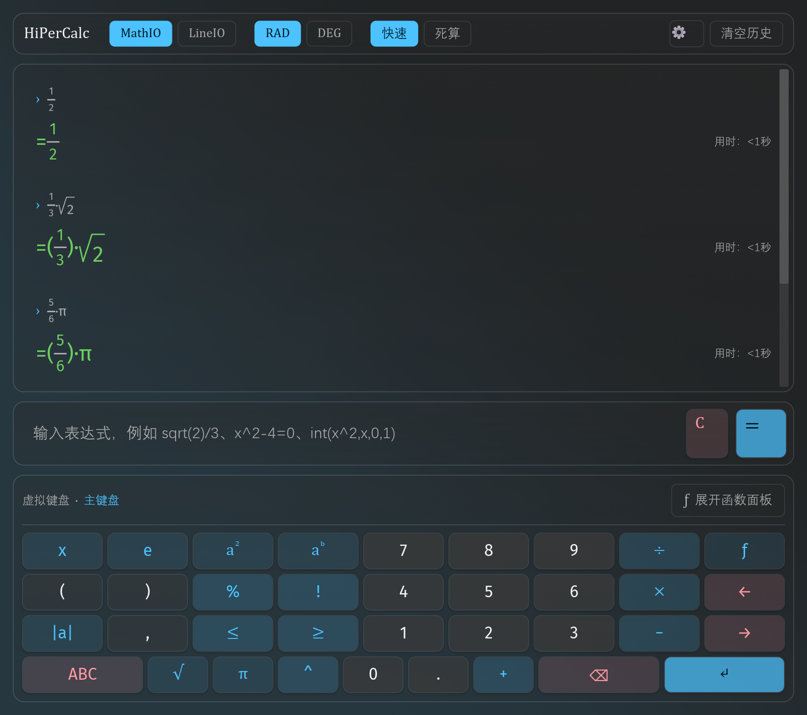
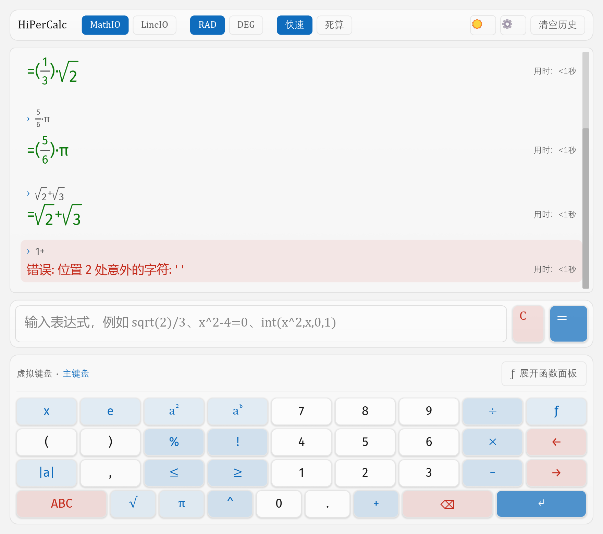
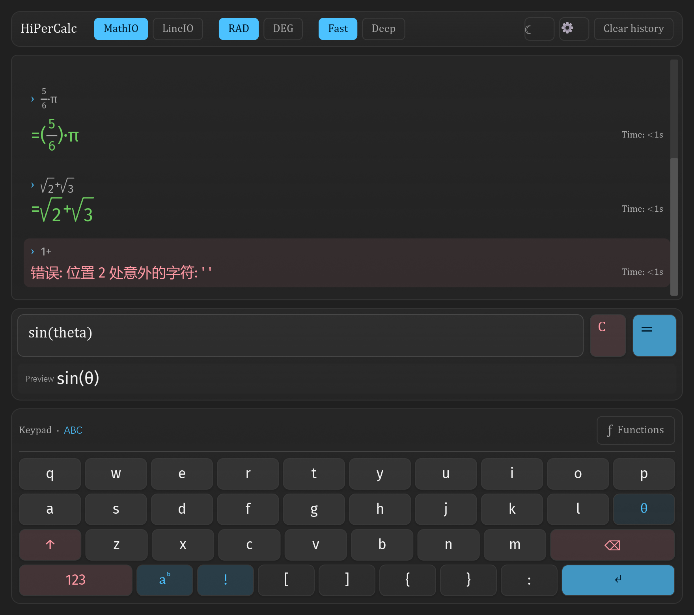
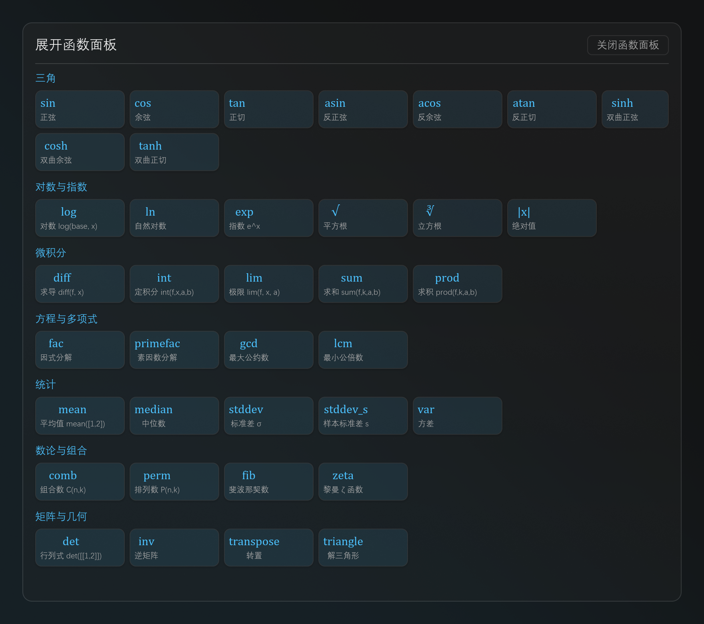
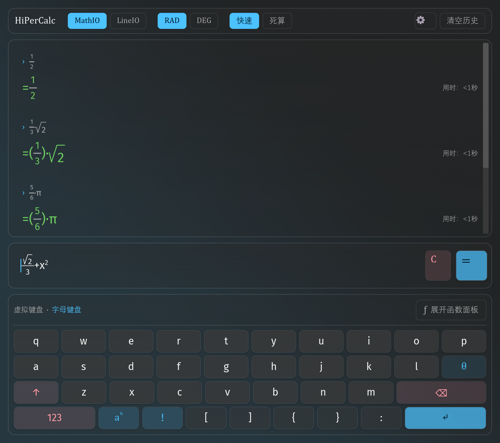
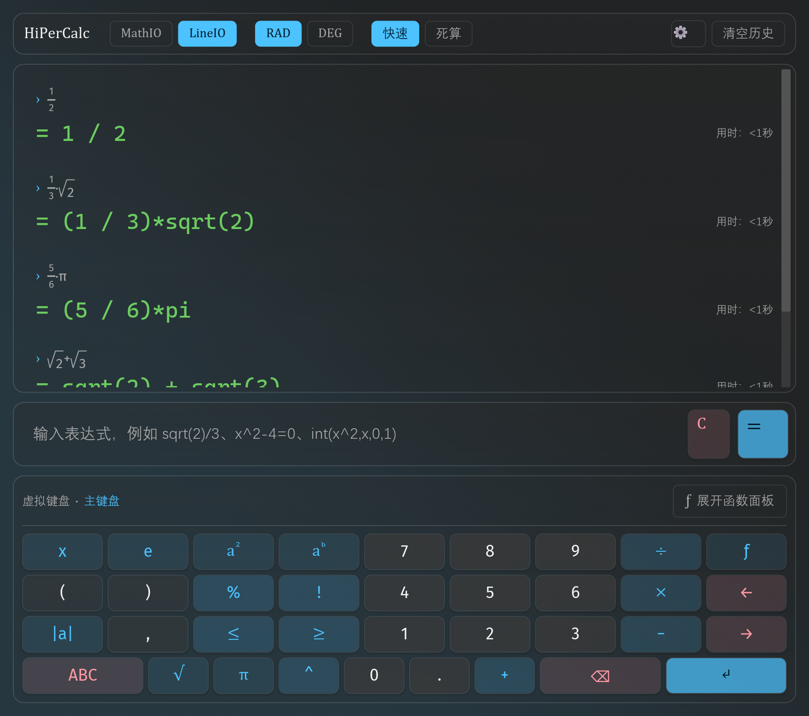
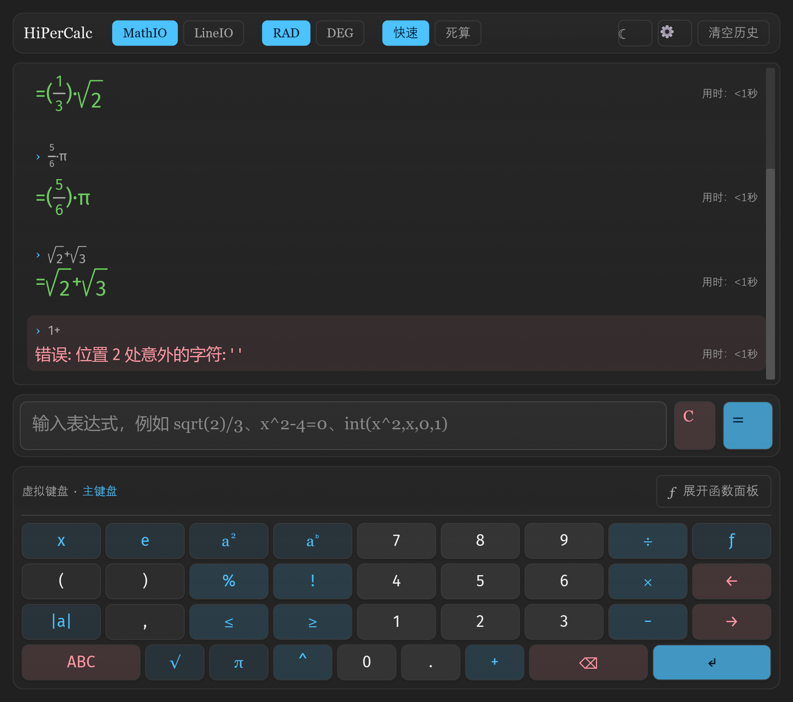
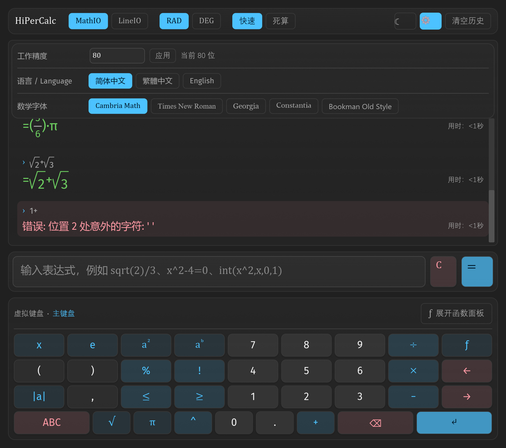

# hipercalc-gui

`hipercalc` 的**图形界面**，基于 [Iced](https://iced.rs)（Elm 架构的跨平台 GUI 库）。



> **当前状态：可用。** 计算 / **后台求值（界面永不卡死）** / **耗时显示** / **配置持久化** / 历史 /
> **预览即输入栏（排版层就是输入框，自绘光标）** / **空参数占位框（可点击定位）** /
> Desmos 式双面板虚拟键盘 / 函数弹窗 /
> 数学排版（分数竖排、**矢量根号**、**Σ/Π 大符号**）/ 深浅双主题（可在设置里切）/ **玻璃强度与底色浓度可调** /
> **长结果折行或横向滚动** / WinUI3 风格玻璃质感 /
> **内置字体（等线 + 5 款数学字体）** / **全界面多语言（简体 / 繁体 / English）** 都已实现，
> 115 项测试全绿（104 单测 + 11 快照测试，后者产出 10 张 PNG 基线）。
> DWM 亚克力的可用性取决于运行环境（见下）。

> 下面所有截图都是 `tests/snapshot.rs` 在**离屏**渲染出来的**真实界面**
> （`docs/` 下的 PNG 与 `tests/snapshots/` 的基线同源）。改界面时重新生成基线并
> 同步更新这里的图，是本 crate 的固定流程。

## 界面构成

界面自上而下四块：**① 工具条 → ② 结果区 → ③ 输入区（含预览行）→ ④ 虚拟键盘**。

| 主界面（深色，主键盘） | 浅色主题 |
|---|---|
|  |  |

- **虚拟键盘**：双面板（数字 / 字母），布局参照 Desmos —— 左列数字与 `ABC` / `√` / `^` / `⌫` / `↵`，
  右侧网格排函数键与比较符。点击插入到**光标处**（不是末尾）。函数键（`√`、`π`…）会自动补括号
  并把光标停在括号内 —— 点 `√` 再打 `2` 直接得到 `sqrt(2)`。

  | 字母面板（并切到 English） | 函数弹窗（7 个分类） |
  |---|---|
  |  |  |

- **光标常显**：`text_editor` 没有 `on_focus` / `on_blur` 回调，只能**主动 focus** ——
  凡是"点了按钮但意图仍是继续输入"的动作（键盘按键、切面板、切语言），`update` 末尾都会调
  `operation::focus(INPUT_ID)`，避免"打了数字却不知道光标在哪"。
- **键盘面垂直居中**：`button` 的内容默认贴在**左上角**（`iced_widget` 的 `layout::padded`
  把内容 `move_to((padding.left, padding.top))`，且 `button` 没有 `center_y` 之类的 API）。
  所以键面要包一层 `container(..).width(Fill).height(Fill).center_x(Fill).center_y(Fill)`
  才会落在正中央 —— 否则键上的字符肉眼可见地**偏上**。
- **Enter = 求值，Ctrl+Enter = 换行**：`text_editor` 把 `Enter` 与 `Ctrl+Enter` 映射成**同一个**
  `Edit::Enter`（绑定表不看修饰键），所以只能靠键盘订阅自己跟踪 `ModifiersChanged`，
  在 `Message::Edit` 里按 `ctrl_held` 分流。多行输入在求值时**逐行求值**，
  只有最后一行推进历史，中间行的 `ans` 累积生效。
- **实时预览行**：`text_editor` 自己排版自己的文本，**没有**"在光标处画一根号"的扩展点
  （唯一的钩子 `Highlighter` 只有 `color` / `font` 两个字段）。所以根号渲染走**分层方案**：
  输入栏保持纯文本编辑，其下方一条预览行用 `mathrender` 把当前行排成 Desmos 样式。

  

- **数学排版**：`mathrender.rs` 把 core 的 MathIO 文本解析成语法树再排版。
  难点是分数分子的边界 —— `-1 / 4 + (1 / 4)*sqrt(5)` 里分子只能是 `-1`，
  不能把后面的 `+ (1/4)√5` 也吸进去（有专项单测 `fraction_numerator_stops_at_plus`）。
- **根号是矢量画的**：早期的做法是"`√` 字符 + 上面一条 `Rule`"，但 `√` 字形的墨迹顶
  够不到行盒顶部 ⇒ 顶钩与顶线之间**上下分离**，且随字体变化。现在改用 `canvas`
  把 `√` 折线与顶线画成**一条连续折线**（同一路径，结构上不可能分离），
  顶线宽度也精确等于被开方式宽。详见 `mathrender.rs` 的 `Radical`。
- **根号始终渲染**：表达式**回显**永远按数学排版，与显示模式无关 ——
  即使切到 LineIO，`› sqrt(2)+sqrt(3)` 仍显示成 `√2+√3`（只有**结果**退化成小数）。
- **⚠️ 报错信息不走数学排版**：`mathrender::tokenize` 会把空格整段吃掉（MathIO 语义要求），
  而报错信息是**散文**（`错误: 位置 2 处意外的字符: '@'`）。所以 `history_entry` 里传入的是
  `math && !e.error` —— 否则快照里会看到 `错误:位置2处意外的字符:"`（空格没了）。

  | LineIO：结果退化小数、**回显仍是根号** | 换数学字体（Georgia）后整屏文字跟着换 |
  |---|---|
  |  |  |

## 后台求值：界面永不卡死

> 起因：输入 `100^100^10` 后窗口标题变成「**(未响应)**」。`100^100^10` 是
> 10^(10^20) 量级的数，光是把结果格式化成十进制就要跑几十秒 —— 而这段计算原先
> **就跑在 UI 线程上**，事件循环被独占，Windows 判定进程失去响应。

### 结构

`State::update` 里原先直接 `self.session.eval(..)` —— 同步调用、跑在事件循环线程上。
现在 `Session` 被挪进一个**常驻后台线程**独占（`evaluator.rs`），UI 只与它通信：

```text
UI 线程                          工作线程（"hipercalc-eval"）
  ├─ Request::Eval  ──mpsc──▶   session.eval(..)   ← 独占 Session
  ◀──── Evaluated ────────────  （耗时在这里测）
  └─ Request::Config ──mpsc──▶  改显示 / 角度 / 精度 …
```

- **`Evaluator::eval` 返回一条真异步 future**（`futures::channel::oneshot` 唤醒它），
  由 `app.rs` 交给 `Task::perform` —— **整条链路上没有任何线程在等**。
  ⚠️ 这里记一次**真实栽过的坑**：上一版写的是 `Task::perform(wait(), ..)`，
  而 `Task::perform` 的第一个参数收的是 **future 本身**（不是"产生 future 的闭包"），
  所以 `wait()` 在 `update` 里就被执行了；它内部是自旋等待 ⇒ UI 线程原地等求值跑完
  ⇒ 大输入（`100^100^10`）依然「未响应」。当时那条测试用的是 `5000!`（只要十几毫秒），
  自旋几毫秒就返回，**根本抓不到**。现在测试改成自适应断言（见 `app.rs`）。
- **同一条队列保证顺序**：改设置（`Request::Config`）和求值（`Request::Eval`）走同一条
  mpsc，worker 顺序处理 ⇒ "切了模式紧接着算"时，求值**已经按新模式**算，用户不必再算一次。
- **`busy` 防积压**：求值中再按 `=` 直接忽略（键面也换成 `…` 且不给 `on_press`），
  结果区顶部显示「计算中…」，结果回来后自动消失。
- **输入框立刻清空**：结果回来时用户可能已在敲下一句，所以提前清，而不是等 `Evaluated` 到达。
- **降级路径**：worker 线程若已退出（`send` 失败），`block_for` 返回一条错误结果而不是死锁。

### 耗时显示

口径**逐字对齐 CLI**（`crates/hipercalc/src/lib.rs` 的 `Timing::elapsed_text`）：

| 条件 | 显示 |
|---|---|
| < 1 秒 | `用时：<1秒`（**不是** `0秒`） |
| ≥ 1 秒 | `用时：{n}秒`，**整秒向下取整**（1.99s → `1秒`） |
| 关闭计时 | 空串（GUI 恒开） |

- **计时覆盖「逐行 eval」整段**（`Instant::now()` 包住所有行）。耗时大头在结果格式化
  （方程通式识别、根收集、因式分解），不是 parse。
- **贴在结果行最右侧**：`row![result, Space(Fill), timing]` —— iced 没有
  `justify_content: space-between`，`Space(Length::Fill)` 是唯一的"两端对齐"写法。
- **`Entry` 存 `Duration` 而不是格式化好的字符串**：语言可能在算完之后才被切换，
  而「用时」两个字是**界面文案**、要跟着语言走，所以格式化推迟到 `view` 里做。

## 内置字体与多语言

### 字体

`assets/fonts/`（约 **20 MB**，已随仓库提交）内置 6 款，启动时一次性交给
`iced::Settings { fonts, .. }`：

| 用途 | 文件 | 族名 |
|---|---|---|
| 中文界面 | `DengXian.ttf`（16 MB） | `DengXian` |
| 数学（默认） | `Cambria.ttc` | `Cambria Math` |
| 数学（备选 1） | `TimesNewRoman.ttf` | `Times New Roman` |
| 数学（备选 2） | `Georgia.ttf` | `Georgia` |
| 数学（备选 3） | `Constantia.ttf` | `Constantia` |
| 数学（备选 4） | `BookmanOldStyle.ttf` | `Bookman Old Style` |

- **中文字体统一等线**（用户要求）：`fonts::label(s)` 走完文字后自动切到 `DengXian`。
- **符号与字母用数学字体**（用户要求）：公式排版取当前选中的 `MathFont`（设置面板里可切，
  存进程级 `AtomicU8`）。切换后 `Theme` 不变，只换 `Family::Name(..)`。
- **⚠️ 字体必须在窗口创建前给**：`iced::Settings.fonts` 只在建窗口时被读取一次，
  装晚了文字会**静默**退回默认字体（不报错、不警告，只是字形不对）。
- **`.ttc` 集合可以整体加载**：iced 内部用 `fontdb`，`load_font_source` 会先把
  `ttf_parser::fonts_in_collection` 数出 face 数，再逐个 `parse_face_info` 注册 ——
  所以 `Cambria.ttc` 直接丢进去就能按族名取到 `Cambria Math`。

### 多语言



- 词典在 `crates/hipercalc/src/language/{en,zh-TW}.json`，**键是简体原文**
  （`zh-CN.json` 是空表 —— 简体原文即键）。界面侧统一走 `t("…")` / `t_fmt("…", &[..])`。
- **规则：界面里任何一句给用户看的中文都必须过 `t()`**，否则切到 English 会残留中文。
  新增界面文案时**必须同步登记到 `app::tests::UI_STRINGS`**，
  `ui_labels_follow_language` 会强制每条都能被翻译。
- 匹配算法是**子串最长字面优先**（`replace_best` / `match_in`），所以键名要有辨识度 ——
  例如界面按钮用 `展开函数面板`，而不是和 CLI 的 `/set` 分类共用的短键 `函数`。
- **⚠️ 窗口标题切不了语言**：iced 0.14 **只在建窗口时**能设标题
  （`iced::application(..).title(..)`，收的是闭包 `Fn(&State) -> String`，且**只读一次**），
  运行时**没有** `set_title`（`iced_runtime::window` 里只有 `resize` / `minimize` / `maximize` /
  `move_to` / `latest()` / `oldest()`）。切语言时标题保持启动时的语言，这是已知限制。

## 为什么单独一个 crate

- **依赖方向仍然是单向的**：`hipercalc-core ← hipercalc ← hipercalc-gui`。数值底座不碰 GUI，
  GUI 也不往数值层里塞东西。
- 二进制名 `hipercalc` 已经被 CI 冒烟与 release 产物占用，GUI 必须另起一个包名，
  否则会撞产物名（这也是本 crate 叫 `hipercalc-gui`、而不是把 GUI 塞进 `hipercalc` 的原因）。
- **lib + bin 双形态**：界面实现在库里，`main.rs` 只起事件循环。
  拆两半的唯一目的是让 `tests/` 下的集成测试能驱动界面 ——
  集成测试编译的是库，看不到 bin 里的东西。

## 环境要求

| 项 | 值 | 说明 |
|---|---|---|
| Rust | **≥ 1.88** | iced 0.14 的 MSRV；本机 1.97 可用 |
| 工具链 | `stable-x86_64-pc-windows-msvc` | iced 在 Windows 上要 MSVC + Windows SDK |
| 图形 | wgpu（默认）/ tiny-skia（软件兜底） | 默认 feature 同时启用两者 |

**版本选择**：`iced` 取 **0.14**（当前 crates.io 稳定版）。注意 docs 站点的差异——
`docs.iced.rs` 上的首页文档跟的是 **master（0.15.0-dev）**，与 0.14 的 API 有出入。
查 API 请以 **`docs.rs/iced/0.14.0`** 或本地 `cargo doc -p iced --open` 为准。

## 运行与测试

```powershell
cargo run -p hipercalc-gui       # 开窗口
cargo build -p hipercalc-gui     # 只编译
cargo test  -p hipercalc-gui     # 104 单测 + 11 快照测试（产出 10 张 PNG，约 5 秒）
```

> ⚠️ **release 构建不弹控制台窗口**。`main.rs` 顶上有一行
> `#![cfg_attr(not(debug_assertions), windows_subsystem = "windows")]`：
> 不带它时 bin 走「控制台子系统」，双击 exe 会先冒一个黑框。
> 只在 **release** 生效 —— debug 下保留控制台，`eprintln!`（DWM 亚克力探测报告）
> 与 panic 回溯源才看得见。

> 首次编译要拉取并编译 **354 个新依赖**（wgpu / naga / winit …；整个 workspace 的包数从 44 涨到 399），
> 耗时较长（实测 5m34s）；之后增量编译就快了。仓库根 `Cargo.toml` 的 `[profile.dev.package."*"] opt-level = 3`
> 对本 crate 同样生效——第三方依赖在 debug 下也带优化，渲染才不会慢得离谱。
>
> ⚠️ 根 `Cargo.toml` 的 `default-members` **不含**本 crate —— 裸 `cargo build` / `cargo test`
> 只编 `hipercalc-core` + `hipercalc`。要编 GUI 必须显式 `-p hipercalc-gui`。

## 截图验证（改界面的必做步骤）

`tests/snapshot.rs` 用 `iced_test` 做**离屏快照**，基线在 `tests/snapshots/*.png`
（实际文件名会带 `-wgpu` 后缀，共 9 张；另有 1 条不产图的点击模拟测试）。
README 里引用的图在 `docs/` 下，**由基线复制而来**（改了界面要两边一起更新）：

```powershell
Remove-Item crates\hipercalc-gui\tests\snapshots\*.png   # 删掉旧基线
cargo test -p hipercalc-gui --test snapshot              # 重新生成
# 重新生成后，把要放进 README 的那几张复制到 docs/ 并改成语义化文件名
```

- **`matches_image` 在文件不存在时会自己创建并返回 `true`** ⇒ 必须删旧基线才会更新，
  而且跑完**必须用图片查看器打开 PNG 亲眼看一下**。只看"测试变绿"等于没验证 ——
  这条纪律实际救过好几次（根号顶线画反、`C`/`=` 文字被裁、错误信息被吃掉空格、
  根号上下分离、键面偏上，全是肉眼才发现的）。
- **视口尺寸固定为 880×780**（快照测试里的 `VIEWPORT`），与 `main.rs` 的窗口尺寸
  （940×860）**不一致** —— 这是历史遗留，快照只要求自身稳定，不要求与真实窗口等大。
- ⚠️ **离屏快照看不到桌面透出**，所以它**无法证明 DWM 亚克力真的生效**。
  那一项只能在真实桌面上人工确认。
- 本机**系统级抓屏不可用**（`Add-Type` 被安全策略拦、`Screen.Bounds` 返回空、
  `Bitmap.Save` 静默失败）⇒ 别再走 PowerShell + `System.Drawing` 这条路。

## 玻璃质感怎么来的

- **纯 iced 部分**（`theme.rs`，零系统依赖）：半透明渐变底 + 1px 高光描边 + 柔和投影，
  叠出"玻璃厚度"的观感。深浅两套 WinUI3 令牌（强调色 `#4CC2FF` / `#0F6CBD`）。
- **真正的桌面模糊**（`backdrop.rs`）必须调 DWM。iced 0.14 **不暴露原生窗口句柄** ⇒
  用 `EnumWindows` + `GetWindowThreadProcessId` 按 PID 反查 HWND，然后逐级降级：
  `DWMWA_SYSTEMBACKDROP_TYPE`(3=Acrylic / 2=Mica) → `DWMWA_MICA_EFFECT`
  → `SetWindowCompositionAttribute` + `ACCENT_ENABLE_ACRYLICBLURBEHIND` → 不透明回退。
- **失败时不假装成功**：探测结果交给 `theme::set_acrylic`，失败时窗口背景退回不透明，
  并 `eprintln!` 如实报告。远程桌面 / 无头环境下失败是预期行为，功能完全正常。

## Iced 核心概念速查（0.14）

```rust
// 入口：State::default 造状态，update 改状态，view 画界面
fn main() -> iced::Result {
    iced::application(State::default, State::update, State::view)
        .title("标题")
        .window(window::Settings { size: iced::Size::new(880.0, 780.0), ..Default::default() })
        .run()
}

struct State { clicks: u64 }

#[derive(Debug, Clone)]                 // Message 必须 Clone
enum Message { Increment }

impl State {
    // 只改状态；要跑异步任务才返回 Task<Message>
    fn update(&mut self, message: Message) -> Task<Message> {
        match message { Message::Increment => self.clicks += 1 }
        Task::none()
    }

    // 只读状态；返回任何 `Into<Element>` 的类型
    fn view(&self) -> Element<'_, Message> {
        column![
            text(self.clicks),
            button("+").on_press(Message::Increment),
        ]
        .spacing(10)
        .padding(20)
        .into()
    }
}
```

三个要点：

1. **`view` 里所有 widget 的 `Message` 类型必须与 `update` 一致**——这是编译器强制的，写错了不会跑偏。
2. **文本不会自动换行/滚动**，长结果要用 `scrollable` 包一层。
3. 组件是**构建器模式**（`.size(20)`、`.padding(10)`、`.style(...)`），不是配置对象。

### 踩过的 API 陷阱

写新界面代码前先扫一眼这份清单，能省掉一轮编译错误（第一版撞了 22 个）：

| 想写 | 实际不存在 | 正确写法 |
|---|---|---|
| `Space::with_width(10.0)` | ✗ | `Space::new().width(Pixels(10.0))` |
| `Rule::horizontal(1.0).width(w)` | ✗ | 放进 `container(..).width(Length::Fixed(w))` |
| `color.scale_rgb(..)` | ✗ | 只有 `scale_alpha`，亮度变化用 alpha 表达 |
| `Background::Gradient(linear)` | 类型不符 | `Background::Gradient(iced::Gradient::Linear(linear))` |
| `Background::from(color)` | ✗ | `Background::Color(color)` |
| `Action::Edit(Edit::Move(..))` | `Edit` 里没有 `Move` | `Action::Move(Motion::Left)`（顶层变体） |
| `text_editor(..).width(Length::Fill)` | 只收 `Pixels` | 让它自然占满 `Row` 的剩余空间 |
| `text_editor(..).on_focus(..)` | ✗ 没有该回调 | 用 `operation::focus(INPUT_ID)` **主动**聚焦 |
| `text_editor` 里自绘符号（画根号） | ✗ 没有扩展点 | `Highlighter` 只有 `color`/`font`，只能分层（另起预览行） |
| `button(..).center_y(..)` | `button` 没有该 API | 内容包一层 `container(..).width(Fill).height(Fill).center_y(Fill)` |
| 靠 `text_editor` 区分 `Enter` / `Ctrl+Enter` | 两者都映射成 `Edit::Enter` | 键盘订阅跟踪 `ModifiersChanged`，自己记 `ctrl_held` |
| 画自定义形状（根号折线） | 默认 feature 没开 canvas | `iced = { features = ["canvas"] }`，用 `Canvas::new(program)` |
| `iced::widget::canvas::mouse::Cursor` | 模块是私有的 | `iced::mouse::Cursor` |
| `iced_application(..).title(some_string)` | 收的不是 `String` | `.title(fn(&State) -> String)`（闭包） |
| 运行时改窗口标题 | ✗ 0.14 无 `set_title` | 只能建窗口时设一次 |
| `iced::application(..).run_with(..)` | ✗ | 窗口就绪用 `window::events()` 订阅 |
| `window::get_latest()` | ✗ | `window::latest()` |
| `iced_test::Settings` | 根上没导出 | `iced_test::core::Settings` |
| `iced_test::Snapshot` | 根上没导出 | `iced_test::simulator::Snapshot` |
| `Grid::columns(n)` 想要自动换行 | 会但**整行等高** | 手动 `chunks(COLS)` 切行 + 每行一个 `Row` |
| `Space::new(Length::Fill, 0.0)` | `Space::new(w, h)` 已废弃 | `Space::new().width(Fill).height(Length::Shrink)` |
| 想让一行两端对齐 | ✗ 没有 `justify_content` | `row![左, Space(Fill), 右]` |
| 在 `update` 里跑慢计算 | 会冻结事件循环 ⇒ 窗口「未响应」 | 挪进后台线程，用 `Task::perform` 回传 |

另外几条容易忽略的：

- **`iced::widget::text_editor` 既是模块名又是函数名** —— 同文件里 `use ..::{Action, Edit, Motion}`
  会撞名，内容类型要写成 `Content as EditorContent`。
- **`mathrender::render(src, ..)` 有生命周期陷阱**：返回类型虽未与入参 `&str` 绑定，但它内部
  会 `text(src.to_string())` ⇒ 借用检查器把返回值生命周期追到入参 ⇒ 局部变量会报
  `cannot return value referencing local variable`。**解法是先 `parse` 得到拥有所有权的 `Node`，
  再 `build`**（为此把 `build` 改成 `pub`）。
- **`canvas` 不在 iced 默认 feature 里**：根号用 `Canvas` 画（见 `Radical`），
  所以本 crate 的 Cargo.toml 显式开了 `features = ["canvas"]`。
  `Program::draw` 的 `Vec<Geometry>` 是 `Vec<Geometry<Renderer>>`，
  写 `Frame::new(renderer, bounds.size())` 再 `frame.into_geometry()` 即可；
  自定义形状用 `Path::new(|p| { p.move_to(..); p.line_to(..); })` + `frame.stroke(..)`。
- **进程级开关（明暗主题、数学字体）会让测试互相干扰**：样式函数签名是 `Fn(&Theme) -> Style`、
  拿不到 `State`，只能存 `AtomicBool` / `AtomicU8`。因此**所有读写它的测试必须串行**
  （快照测试里有一把 `SERIAL: Mutex<()>`；`.cargo/config.toml` 里另设了 `RUST_TEST_THREADS = "1"`），
  否则 `cargo test` 的多线程会让"深色刚设 true、浅色刚要渲染"互相覆盖。
- **⚠️ 语言必须在 UI 线程同步设置**：界面每处文案都在**当帧 `view`** 里读 `i18n` 的进程级
  全局量。若把"设语言"也丢给后台 worker 执行，就变成**异步**的 —— 界面不会立刻变
  （按钮"有时不灵"），测试还会跨用例污染（一个用例刚还原中文，被另一个用例的 worker
  延迟改回英文，报 `"Fast" != "快速"`）。所以 `evaluator::Command` **刻意不含 `SetLang`**，
  语言只走 UI 线程同步路径（`hipercalc::session::set_ui_lang`）。
- **`Task::perform` 的闭包内部阻塞是正确用法**：iced 把 task 放进线程池跑，不是事件循环
  线程 —— 那里正是"该阻塞"的地方。真正的红线是**别在 `update` 本体里同步阻塞**。

## 参考资料

原始文档与源码已下载到仓库根的 `.iced-ref/`（**已加入 `.gitignore`，仅本地保留**）：

```text
.iced-ref/site/         docs.iced.rs / book.iced.rs / docs.rs 的离线快照 + widget 索引
.iced-ref/src/          iced 0.14.0 完整源码（含 src/application.rs —— 入口 API 的权威来源；
                        iced_runtime/src/window.rs —— 判断"哪些窗口操作运行时可用"）
.iced-ref/examples/     官方示例 counter / todos / tour / integration / component
.iced-ref/tutorial/     社区教程 65 章（**按 0.13.1 写的**，概念可读、API 细节要回 0.14 核对）
```

重新获取：

```bash
# 文档（curl 可直连）
curl -sL https://docs.iced.rs/iced/ -o .iced-ref/site/docs.iced.rs.html
curl -sL https://docs.rs/iced/0.14.0/iced/ -o .iced-ref/site/docs.rs-0.14.0.html
# 源码 / 示例（GitHub 直连被墙，走 gh）
gh api repos/iced-rs/iced/contents/examples/counter/src/main.rs?ref=0.14.0 \
   -H "Accept: application/vnd.github.raw" > .iced-ref/examples/counter/main.rs
curl -sL -H "User-Agent: hipercalc" https://crates.io/api/v1/crates/iced/0.14.0/download \
   | tar xz -C .iced-ref/src
```
